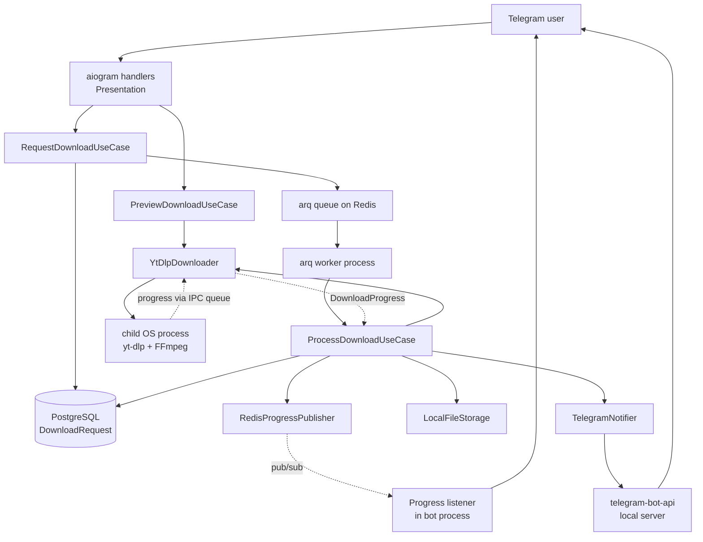
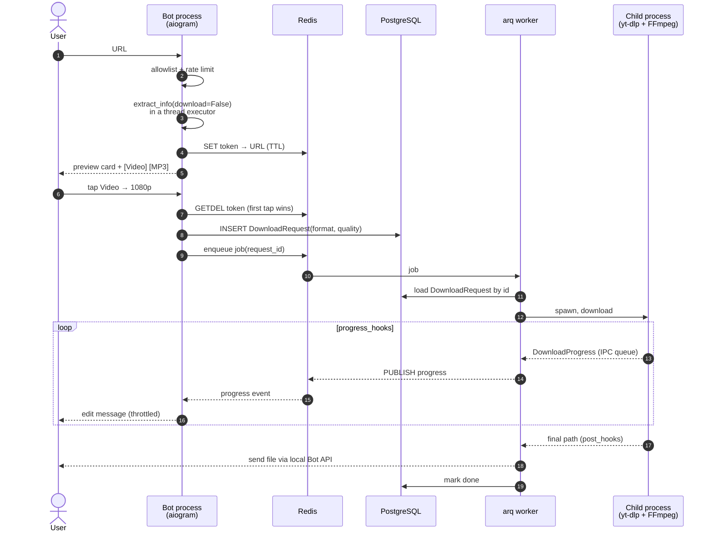

# Universal Media Downloader

[](https://github.com/IvanSytnik/Universal-Media-Downloader/actions/workflows/ci.yml)
[](https://www.python.org/downloads/release/python-3130/)
[](https://github.com/astral-sh/ruff)
[](https://mypy.readthedocs.io/en/stable/command_line.html#cmdoption-mypy-strict)
[](#testing)
[](LICENSE)

A production-grade Telegram bot that downloads media from YouTube, TikTok, Instagram, X/Twitter and VK via `yt-dlp` — built as the core of a future SaaS platform rather than as a single-file script.

The interesting part of this project is not the download itself. It is everything around it: keeping a blocking, crash-prone third-party library isolated from an asyncio event loop, delivering files larger than Telegram's 50 MB limit, streaming real-time progress across process boundaries, and keeping the domain layer free of any knowledge that Telegram exists.

---

## Overview

**Problem.** Telegram media downloader bots typically collapse under three constraints: `yt-dlp` is synchronous and can hang indefinitely; the Bot API rejects files over 50 MB; and long downloads leave the user staring at a silent chat.

**Approach.** Each constraint is solved architecturally, not patched:

| Constraint | Solution |
|---|---|
| `yt-dlp` blocks and can hang | Each download runs in a dedicated OS process (`multiprocessing.Process`), killed by `terminate()` on timeout — a thread cannot be safely killed, a process can |
| 50 MB upload limit | A self-hosted `telegram-bot-api` container sharing a Docker volume with the worker, raising the ceiling to 2000 MB |
| No feedback during long downloads | `progress_hooks` → inter-process queue → Redis pub/sub → a long-lived listener in the bot process edits the message, throttled |
| Downloader must not know about Telegram | Progress leaves the downloader as a domain value object through a port; only the presentation layer converts it into an `editMessageText` call |

**Audience.** Telegram users who want video or MP3 from a link, with a two-step confirmation flow and localized interface (ru/en).

**Status.** Working end to end: preview → format choice → quality choice → download → delivery, with real-time progress and categorized, localized error messages. 343 tests with 99% coverage of the domain and application layers (CI gate: 90%), `ruff` and `mypy --strict` clean.

---

## Key Features

- **Two-phase download flow.** `extract_info(download=False)` produces a preview card (title, duration, thumbnail) before a single byte is downloaded — the user confirms, and only then does a worker job get queued.
- **Format selection.** Video (MP4) or audio (MP3 via `FFmpegExtractAudio`), chosen with inline buttons under the preview.
- **Quality selection.** Two-step keyboard: Video → 720p / 1080p, encoded in the callback payload and persisted as a domain property.
- **Large file delivery.** Optional self-hosted Bot API server lifts the upload limit from 50 MB to 2000 MB.
- **Real-time progress.** Percentage, speed and ETA pushed from the download subprocess to the chat message, with throttling to stay within Telegram rate limits.
- **Categorized errors.** `yt-dlp` failures are classified into seven domain exception types (private, geo-blocked, age-restricted, unavailable, unsupported media, timeout, too large). The user sees a short localized sentence; the raw diagnostic goes to the structured log only.
- **Internationalization.** Every user-facing string lives in Fluent `.ftl` files (ru/en) with Russian plural forms and a manual `/language` switch.
- **Rate limiting.** Redis sliding-window counters (ZSET), applied per Telegram user at the presentation boundary — separate limits for previews and downloads.
- **Domain allowlist.** URLs are validated against a configurable suffix-match allowlist before reaching the application layer.

---

## Tech Stack

| Layer | Technology | Purpose |
|---|---|---|
| Language | Python 3.13 | `from __future__ import annotations`, modern typing throughout |
| Telegram | aiogram 3 | Async-native bot framework; FSM on Redis storage |
| Download engine | yt-dlp (`>=2026.08.19`) | Native Python API (`YoutubeDL`), not a CLI wrapper |
| Media processing | FFmpeg | System binary; MP4 merge and MP3 extraction |
| JS runtime | Deno | Required by `yt-dlp-ejs` — YouTube metadata extraction degrades without it |
| Task queue | arq | Async-native, Redis-backed; matches the asyncio stack without an adapter layer |
| Database | PostgreSQL 16 | Via SQLAlchemy 2 (async) + asyncpg |
| Migrations | Alembic | Applied on bot container startup |
| Cache / broker / pub-sub | Redis 7 | FSM storage, arq broker, rate limiter, progress channel, preview context |
| i18n | aiogram-i18n + fluent.runtime | FTL locale files, missing key = hard error |
| Config | pydantic-settings | Single source of truth, `SecretStr` for credentials |
| Logging | structlog | Structured logs over the stdlib logger factory |
| Testing | pytest, pytest-asyncio, pytest-cov, aiosqlite | 343 tests; repositories tested against SQLite; coverage gate on core layers |
| Quality | ruff, mypy (strict) | Enforced in CI |
| Infrastructure | Docker, Docker Compose | Multi-stage, non-root image; five services |
| CI | GitHub Actions | Lint → type check → test + coverage gate → image build on every push and PR to `main` |

---

## Architecture

Clean Architecture with an enforced dependency rule. The domain layer imports nothing from the outside — no aiogram, SQLAlchemy, Redis or yt-dlp; the application layer depends only on domain ports; infrastructure implements those ports; presentation calls application use cases and never touches infrastructure directly.

The rule is checked by tests, not by convention: `tests/unit/test_architecture.py` parses every module under `src/` with `ast` and fails the build on any import that crosses a layer boundary the wrong way, including imports hidden under `if TYPE_CHECKING:`.

**Composition root.** All wiring happens in one place. `src/main.py` builds the long-lived resources (engine, Redis, arq pool), and `src/composition.py` turns concrete adapters into use cases behind a `UseCaseProvider` protocol that the presentation layer declares (`src/presentation/telegram/dependencies.py`). The dispatcher injects the provider and the domain ports into handlers through aiogram workflow data. A handler asks for `use_cases.request_download()` and receives a ready use case scoped to one database transaction; it never sees a session, a repository class or Redis.

```
Presentation  →  Application  →  Domain  ←  Infrastructure
```

The critical insight in this codebase: **the Telegram handler and the arq worker are two entrypoints into the same application layer**, not two parallel systems. A handler validates input and enqueues; a worker dequeues and executes. Both call use cases.



### Lifecycle of one download



### Ports defined by the domain

`DownloaderPort`, `StoragePort`, `NotifierPort`, `TaskQueuePort`, `UserRepositoryPort`, `DownloadRequestRepositoryPort`, `RateLimiterPort`, `PreviewContextStorePort`, `ErrorLocalizerPort`, `ProgressPublisherPort`, `HealthCheckPort`, `PingResultReader`.

Every one of these has exactly one infrastructure implementation today and could gain a second (S3 storage, a REST notifier, a gallery-dl downloader) without touching the domain or application layers.

### Data flow of one download

1. User sends a URL. The handler validates it against the domain allowlist and checks the Redis rate limiter.
2. `PreviewDownloadUseCase` calls `extract_info(download=False)`; the URL is stored in Redis under a short-lived token, and a preview card is rendered with format buttons.
3. The user picks video/MP3 and, for video, a quality tier. The callback payload carries the token plus the choice.
4. `RequestDownloadUseCase` persists a `DownloadRequest` entity (with `format_kind` and `quality_kind`) and enqueues a job carrying only the request id plus the message coordinates for progress rendering.
5. The worker's `ProcessDownloadUseCase` reloads the entity from the database, builds `DownloadOptions`, and calls the downloader.
6. `YtDlpDownloader` spawns a child process. Progress hooks push updates through an inter-process queue; the parent drains them into Redis pub/sub. A timeout triggers `terminate()`.
7. On success the file path is resolved from `post_hooks` (the only reliable source after an FFmpeg merge or transcode), delivered through the notifier, and cleaned up.

---

## Project Structure

```text
umd/
├── src/
│   ├── domain/                  # No outbound dependencies
│   │   ├── entities/            # User, DownloadRequest
│   │   ├── value_objects/       # FormatKind, QualityKind, MediaType,
│   │   │                        #   DownloadOptions, DownloadProgress,
│   │   │                        #   MediaPreview, url_validation
│   │   ├── interfaces/          # All ports
│   │   └── exceptions.py        # Domain errors, each carrying an error_key
│   ├── application/use_cases/   # RegisterUser, SetUserLanguage,
│   │                            #   PreviewDownload, RequestDownload,
│   │                            #   ProcessDownload
│   ├── infrastructure/
│   │   ├── downloader/          # yt-dlp adapter + error classifier
│   │   ├── database/            # SQLAlchemy models, async repositories
│   │   ├── queue/               # arq worker settings and jobs
│   │   ├── storage/             # Local file storage with TTL cleanup
│   │   ├── notifier/            # Telegram file delivery
│   │   ├── progress/            # Redis pub/sub publisher
│   │   ├── rate_limit/          # Redis sliding-window limiter
│   │   ├── preview_context/     # Token → URL, Redis, atomic GETDEL
│   │   └── localization/        # Fluent localizer for the worker path
│   ├── presentation/telegram/   # Thin handlers, keyboards, formatting,
│   │                            #   i18n middleware, progress listener,
│   │                            #   dependencies.py (UseCaseProvider contract)
│   ├── config/settings.py       # pydantic-settings, single source of truth
│   ├── shared/logging.py        # structlog configuration
│   ├── composition.py           # Composition root: adapters → use cases
│   └── main.py                  # Bot entrypoint, builds and injects resources
├── locales/{ru,en}/messages.ftl # Every user-facing string
├── infra/
│   ├── alembic/versions/        # 0001_initial … 0004_quality_kind
│   └── docker/                  # bot.Dockerfile, entrypoint.sh
├── tests/
│   ├── unit/                    # Domain, application, presentation logic,
│   │                            #   architecture (layer boundary) tests
│   └── integration/             # Repositories and composition root against SQLite
├── .github/workflows/ci.yml     # Lint, type check, tests + coverage gate, image build
├── docker-compose.yml
├── Makefile                     # Developer shortcuts (`make help`)
├── CHANGELOG.md
├── LICENSE
└── pyproject.toml
```

The layout deliberately splits by architectural layer rather than by process type. A `bot/ worker/ core/ services/` split — the obvious alternative — reliably degrades into `core/` and `services/` becoming dumping grounds, and it makes the dependency rule impossible to check by reading an import statement.

---

## Getting Started

### Prerequisites

- Docker and Docker Compose
- A bot token from [@BotFather](https://t.me/BotFather)
- Optional, for files above 50 MB: an `api_id` / `api_hash` pair from [my.telegram.org/apps](https://my.telegram.org/apps) (free application registration, unrelated to the bot token)

For running tests and linters outside Docker: Python 3.13.

### Installation

```bash
git clone <repository-url>
cd umd

cp .env.example .env
# Set BOT_TOKEN. For large-file support also set TELEGRAM_API_ID,
# TELEGRAM_API_HASH, USE_LOCAL_BOT_API=true and raise
# MAX_DELIVERABLE_FILE_SIZE_MB (up to 2000).

docker compose up --build      # or: make up
```

The bot container runs `alembic upgrade head` on startup before launching. The worker container explicitly overrides its entrypoint to skip migrations — two containers racing on `alembic upgrade head` is a real failure mode, not a hypothetical one.

Postgres and Redis are published on non-standard host ports (`5433` and `6380`) to avoid clashing with locally installed instances. Change `HOST_POSTGRES_PORT` / `HOST_REDIS_PORT` if needed.

### Local development

```bash
python3.13 -m venv .venv && source .venv/bin/activate
pip install -e ".[dev]"      # or: make install
```

Common tasks are wrapped in the `Makefile`:

| Command | What it does |
|---|---|
| `make lint` | `ruff check` + `ruff format --check` + `mypy --strict` |
| `make format` | `ruff format` + `ruff check --fix` |
| `make test` / `make test-cov` | Test suite / with the coverage gate |
| `make up` / `make down` / `make logs` | Compose stack lifecycle and bot + worker logs |
| `make migrate` | `alembic upgrade head` inside the bot container |

The full stack still needs Docker for Postgres and Redis; the local environment exists for the quality gate below.

---

## Environment Variables

| Variable | Required | Default | Description |
|---|:--:|---|---|
| `BOT_TOKEN` | Yes | — | Telegram bot token from @BotFather |
| `ENVIRONMENT` | No | `local` | `local` / `staging` / `production` |
| `LOG_LEVEL` | No | `INFO` | structlog level |
| `USE_LOCAL_BOT_API` | No | `false` | Route bot and worker to the self-hosted Bot API server |
| `TELEGRAM_API_ID` | No | — | Required only when `USE_LOCAL_BOT_API=true` |
| `TELEGRAM_API_HASH` | No | — | Required only when `USE_LOCAL_BOT_API=true` |
| `LOCAL_BOT_API_BASE_URL` | No | `http://telegram-bot-api:8081` | Address of the local Bot API server |
| `MAX_DELIVERABLE_FILE_SIZE_MB` | No | `50` | Upload ceiling; raise to 2000 with the local server |
| `DEFAULT_LOCALE` | No | `en` | Fallback when the user has no override and no recognizable `language_code` |
| `ADMIN_TELEGRAM_IDS` | No | `[]` | JSON list of Telegram user ids allowed to run `/health`, `/worker_ping`, `/worker_status`. Empty list denies everyone |
| `ALLOWED_DOMAINS` | No | YouTube, TikTok, Instagram, Twitter/X, VK | JSON list; suffix match per label. Empty list disables the allowlist (development only) |
| `PREVIEW_CONTEXT_TTL_SECONDS` | No | `600` | How long a preview's confirm button stays actionable |
| `RATE_LIMIT_DOWNLOADS_PER_HOUR` | No | `10` | Per Telegram user |
| `RATE_LIMIT_PREVIEWS_PER_MINUTE` | No | `5` | Per Telegram user |
| `DOWNLOAD_TIMEOUT_SECONDS` | No | `1800` | Hard ceiling per download job; the subprocess is terminated on expiry |
| `FILE_UPLOAD_TIMEOUT_SECONDS` | No | `1800` | Per-request timeout for the upload leg specifically |
| `POSTGRES_HOST` / `POSTGRES_PORT` / `POSTGRES_DB` / `POSTGRES_USER` / `POSTGRES_PASSWORD` | No | `postgres` / `5432` / `umd` / `umd` / `umd` | In-network database connection |
| `REDIS_HOST` / `REDIS_PORT` / `REDIS_DB` | No | `redis` / `6379` / `0` | In-network Redis connection |
| `HOST_POSTGRES_PORT` / `HOST_REDIS_PORT` | No | `5433` / `6380` | Host-side published ports (Compose only) |

Secrets are read from `.env`, wrapped in `SecretStr`, and never logged. `.env` is git-ignored.

---

## Database

Four Alembic migrations define the current schema:

| Revision | Change |
|---|---|
| `0001_initial` | `users`, `download_requests` |
| `0002_user_language` | `users.language` (nullable) |
| `0003_format_kind` | `download_requests.format_kind`, `NOT NULL`, server default `video` |
| `0004_quality_kind` | `download_requests.quality_kind`, `NOT NULL`, server default `hd_720` |

```bash
docker compose exec bot alembic upgrade head
docker compose exec bot alembic current
```

`User.telegram_id` is deliberately **not** the primary key. It is one authentication method among future others (API keys, JWT); making it the key would force a rewrite of the user model and every foreign key the moment a second client appears.

---

## Testing

```bash
pytest                 # 343 tests
pytest tests/unit      # Domain, application, presentation logic
pytest tests/integration

make test-cov          # with the coverage gate, as CI runs it
```

**Coverage gate.** CI runs the suite with `--cov=src/domain --cov=src/application --cov-fail-under=90` (branch coverage on) and fails the build below the threshold. Current coverage of those layers is 99%. The gate deliberately targets the core: that is where the business rules live, and the adapters around it are exercised by unit tests against fakes and by live runs in Docker.

`pytest-asyncio` runs in `auto` mode, so async tests need no decorator.

**Unit tests** cover use cases, the URL allowlist and validator, the `yt-dlp` options builder (per format and per quality branch), the error classifier against a corpus of real `yt-dlp` message strings, the localizer, callback encoding/decoding including byte budget and legacy payloads, the progress throttler, the rate limiter, message formatting under i18n, and the subprocess kill mechanism.

**Integration tests** exercise the SQLAlchemy repositories against SQLite through `aiosqlite`, including the language and quality round trips, and the composition root's transaction boundary (commit on success, rollback on exception).

**Architecture tests** enforce the dependency rule on every run: domain imports only the standard library, application only domain, and presentation never imports infrastructure. A self-test proves the scanner catches every import form, so the check cannot pass vacuously.

Two testing habits worth calling out, both introduced after real bugs:

- **Argument-capture tests.** Mocking the downloader without asserting on the `DownloadOptions` it received once let a bug ship where the MP3 button silently delivered video: the field was persisted correctly but never threaded into the worker's read path. Tests now capture and assert the actual arguments.
- **Migrations are verified by running them.** Unit tests do not execute Alembic. A revision id longer than 32 characters passes every test and then fails at runtime on `UPDATE alembic_version` — after the DDL has already run.

---

## Code Quality

```bash
make lint      # ruff check, ruff format --check, mypy --strict
```

CI runs on Python 3.13 for every push and pull request to `main`:

1. `ruff check src tests`
2. `ruff format --check src tests`
3. `mypy --strict src`
4. `pytest` with the domain + application coverage gate (≥ 90%)
5. `docker build` of the production image

`ruff` is configured with `E`, `F`, `I`, `UP`, `B`, `SIM` rule sets at a 100-character line length.

---

## Internationalization

All presentation strings live in `locales/ru/messages.ftl` and `locales/en/messages.ftl`. The two files are structurally identical by key; a missing key raises rather than silently rendering the identifier, and a test enforces the invariant.

Locale resolution order: explicit `/language` override stored in Redis → Telegram `language_code` hint → `DEFAULT_LOCALE`.

The domain layer carries no strings. Domain exceptions carry a semantic `error_key`; both the handler path (via `I18nContext`) and the worker path (via `ErrorLocalizerPort` with an explicit locale, since no update context exists there) resolve that key into text at the boundary.

---

## Security

- **URL allowlist**, not a blocklist — validated at the presentation boundary before anything reaches the application layer.
- **Filename sanitization** delegated to `yt-dlp`'s `restrictfilenames`, avoiding a hand-rolled sanitizer.
- **No shell**. FFmpeg and `yt-dlp` are driven through the Python API and list arguments; no string concatenation into a shell command.
- **HTML escaping** of every externally sourced string (titles, usernames, URLs) before substitution, since Fluent does not escape.
- **No diagnostic leakage.** Raw `yt-dlp` output goes to the structured log; the user receives a short localized message.
- **Admin-only operational commands.** `/health`, `/worker_ping` and `/worker_status` require the sender to be in `ADMIN_TELEGRAM_IDS`. The allowlist fails closed (empty means nobody), and for everyone else the commands behave as if they did not exist: the update is consumed silently and the attempt is logged.
- **Sanitized health output.** `/health` replies with per-component ✅ / ❌ indicators only. Raw probe errors (driver messages, hostnames, DSNs) go to the structured log and never into a chat, not even an admin's. The domain `HealthReport` has no field that could carry them.
- **Rate limiting** per user on both previews and downloads.
- **Atomic token consumption.** Preview tokens are popped with Redis `GETDEL`, closing the double-tap race on callback buttons.
- **Secrets** live only in `.env`, typed as `SecretStr`, and are excluded from the Docker build context by `.dockerignore`.
- **Unprivileged containers.** The image runs as a dedicated non-root user; build tooling (`uv`, `curl`) stays in the builder stage and never ships.
- **Local-only data ports.** Postgres and Redis are published on `127.0.0.1` only.

---

## Engineering Decisions

**Process isolation over thread isolation for `yt-dlp`.** A hung download inside a thread cannot be killed; the event loop is hostage to it. Each download therefore runs in its own `multiprocessing.Process`, terminated on timeout. The cost is that the format choice must be pickled across the boundary as a plain string and reconstructed as an enum in the child.

**Local Bot API server instead of S3 links or quality downgrading.** Both alternatives change the product — one moves the file out of Telegram, the other silently degrades what the user asked for. A self-hosted `telegram-bot-api` container sharing a Docker volume with the worker keeps delivery inside the chat, at the price of one more service and a `my.telegram.org` registration. The shared volume path must match exactly on both sides: in local mode the server reads the file from disk itself.

**`FormatKind` and `QualityKind` are persisted domain properties; message coordinates are not.** The worker reconstructs the entire request from the database using only its id, so anything describing *what to download* must be persisted. By contrast, the chat and message ids that say *where to draw progress* are transport details and travel in the job payload — putting them in the domain would let Telegram leak across the dependency rule.

**`FormatKind` is a separate value object from `MediaType`.** `MediaType` describes what the source *is*; `FormatKind` describes what the user *asked for*. One video can be requested as MP4 or as MP3 — different intents against the same medium, therefore different concepts.

**Classification by message text, not by exception type.** `yt-dlp` catches its own exception subtypes and re-raises them as a single `DownloadError`, so the subtype is gone by the time it reaches us. The classifier matches stable signatures in the message, ordered by priority, and is tested against a corpus of real strings. A bare `Unsupported URL` is disambiguated by URL shape: a TikTok `/photo/` link is a supported *site* with unsupported *media*, which is a different message to the user.

**Explicit failure on unreadable data.** A `status` value the domain cannot interpret raises `CorruptedRecordError` with an internal error key rather than falling back to a default — a silent fallback would hide database corruption behind normal-looking behaviour.

**No pinned `player_client` for YouTube.** A hardcoded `extractor_args player_client` was itself the cause of a silent quality regression: it went stale, YouTube changed, and downloads degraded to 360p without any error. The fix was to remove the override and pin the `yt-dlp` version instead, letting its default client selection track upstream.

**Final filenames come from `post_hooks`.** Neither `prepare_filename()` nor `requested_downloads` survives an FFmpeg merge or an MP3 transcode — the extension changes underneath them. `post_hooks` is the only hook that reports the path that actually exists on disk.

---

## Known Limitations

- **Telegram's blue command menu ignores `/language`.** It is rendered by the client from the app's own locale, not from our override. Everything else — messages, buttons, previews, errors — follows the switch. Cosmetic and not fixable from the server side.
- **Photos and carousels are rejected, not downloaded.** `yt-dlp` cannot extract Instagram carousel photos on this stack (photo slides return "No video formats found"; TikTok `/photo/` returns "Unsupported URL"). Such posts are detected and declined with an honest message rather than failing obscurely. Supporting them requires a second `DownloaderPort` implementation over a different library.
- **Error signatures are calibrated mainly on YouTube and TikTok.** Instagram, X/Twitter and VK failure strings have not yet been collected from live runs, so those may fall through to the generic category.
- **No metrics or dashboards yet.** structlog gives structured logs; Prometheus and Grafana are planned, not implemented.
- **Integration tests use SQLite, not Postgres.** Repository behaviour is verified through `aiosqlite`; dialect-specific behaviour is therefore not covered by the suite and is checked by running migrations in Docker.
- **Download history is stored but not exposed.** `download_requests` accumulates every request including format and quality, but no history command exists yet.

---

## Roadmap

Ordered by the project's phase plan; only items with a defined design are listed.

- Live error corpus for Instagram, X/Twitter and VK; extend classifier signatures
- Usage policy and rights-holder complaint process — a prerequisite for any monetization
- Prometheus metrics and Grafana dashboards; health checks for every service
- Photo and carousel support behind a second `DownloaderPort` implementation
- Download history surfaced to the user
- Premium tier: subscriptions, per-tier limits via `match_filter`, priority queueing
- Public REST API (FastAPI) with API keys and JWT, sharing the existing application layer
- Web client on top of that API

Deliberately not built yet, per YAGNI: REST/Web/Mobile clients, payments, referrals, admin panel. The architecture leaves room for them; the code does not anticipate them.

---

## License

Released under the [MIT License](LICENSE). Copyright (c) 2026 Ivan Sytnik.
