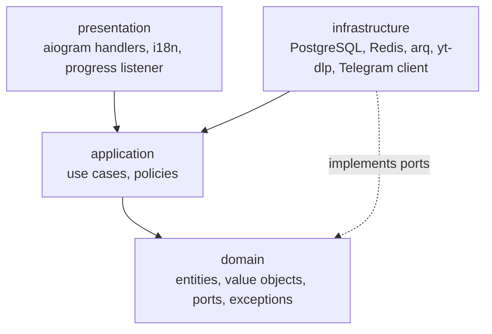
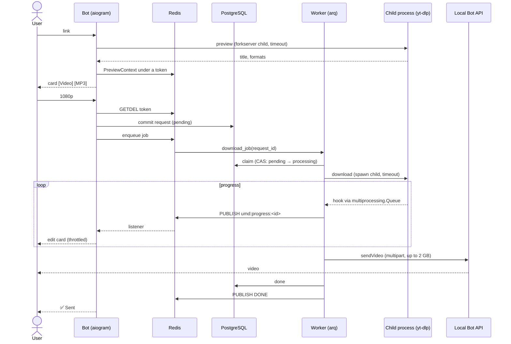
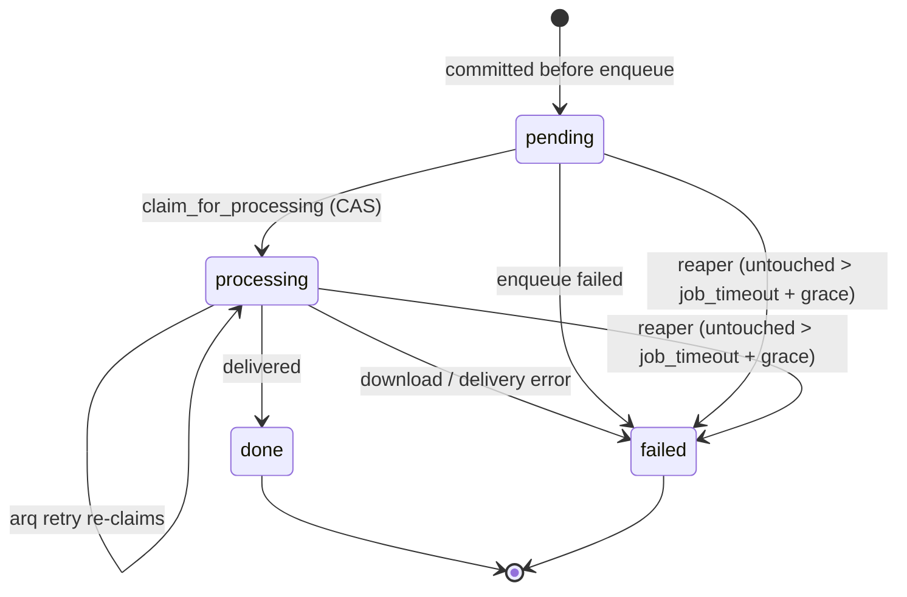

# Universal Media Downloader

[](https://github.com/IvanSytnik/Universal-Media-Downloader/actions/workflows/ci.yml)
[](https://www.python.org/downloads/release/python-3130/)
[](https://github.com/astral-sh/ruff)
[](https://mypy.readthedocs.io/en/stable/command_line.html#cmdoption-mypy-strict)
[](LICENSE)

A Telegram bot that downloads videos and audio from YouTube, TikTok, X and
other sites with `yt-dlp`, lets the user pick the quality, shows live
progress and delivers files of up to 2 GB as playable Telegram videos.

**At a glance**

- **What it does:** send a link, get a preview card, choose *Video* (720p / 1080p) or *MP3*, receive the file in the chat. English and Russian.
- **How it is built:** Python 3.13, aiogram, arq workers, PostgreSQL, Redis, a local Telegram Bot API server, all in Docker Compose. Clean Architecture with the dependency rule enforced by a test.
- **How it is checked:** 686 tests plus 3 PostgreSQL migration tests in CI; `ruff`, `mypy --strict`; a 90% coverage gate on the core layers (99% as of v1.2.0).
- **Status:** pre-beta. Runs end to end on a local Docker stack; not yet deployed to a server and has no production users.

## Demo

<!--
Screenshots go here (English client, test bot). Expected files:
  docs/assets/demo-flow.gif        link → preview → quality → progress → ✅ Sent (10–15 s)
  docs/assets/demo-preview.png     preview card with [Video] [MP3]
  docs/assets/demo-quality.png     [720p] [1080p] [Back]
  docs/assets/demo-progress.png    progress card, "Downloading… 61%"
  docs/assets/demo-delivered.png   "✅ Sent" and the inline video player
  docs/assets/demo-error.png       a localized refusal (unsupported site)


| Preview | Quality | Progress | Delivered |
|---|---|---|---|
|  |  |  |  |
-->

*Screenshots are being prepared.*

## Why this is interesting

The download itself is one library call. The engineering is in keeping a
blocking, crash-prone library away from an asyncio event loop and in
never leaving a user without an answer.

- **Downloads run in killable processes, not threads.** A thread running `yt-dlp` cannot be stopped, and `asyncio.wait_for` only stops waiting. Previews run in a `forkserver` child and downloads in a `spawn` child, both terminated and then killed on timeout. → [ADR 0003](docs/adr/0003-preview-timeout-process-isolation.md), [`ytdlp_downloader.py`](src/infrastructure/downloader/ytdlp_downloader.py)
- **Progress crosses three process boundaries.** yt-dlp hooks in the child → `multiprocessing.Queue` → worker event loop → Redis pub/sub → the bot's listener → throttled `editMessageText`. → [architecture.md, Progress bridge](docs/architecture.md#progress-bridge)
- **No request is lost silently.** Status transitions that a job and the stale-request reaper can race on are compare-and-set updates, with `FOR UPDATE SKIP LOCKED` on the reaper side. Each repository call is its own transaction, and the request row is committed before its job is enqueued. → [ADR 0004](docs/adr/0004-stale-request-reaper.md)
- **Quality is the short side of the frame.** `DownloadSpec = VideoSpec(tier) | AudioSpec` makes meaningless combinations unrepresentable. A vertical 1080x1920 Short is "1080p", and the inline-playable codec is one constant shared by the preview and the download. → [ADR 0001](docs/adr/0001-download-spec-sum-type.md)
- **The database is untrusted input.** An unreadable value degrades to a truthful default or raises a domain error that the worker reports to the user, instead of a `ValueError` after the user was told "accepted". → [architecture.md](docs/architecture.md#the-database-is-untrusted-input)
- **Errors are keys, not text.** yt-dlp failures are classified into domain exceptions carrying an `error_key`, which is rendered through Fluent in the user's language; raw diagnostics go only to logs and Sentry. A test fails on any Cyrillic literal in code, so text cannot bypass the locale files. → [`error_classifier.py`](src/infrastructure/downloader/error_classifier.py)

## Features

- Preview card (title, author, duration) before anything is downloaded.
- Video in 720p, 1080p or the best inline-playable quality; MP3 audio.
- Real-time progress that ends in "✅ Sent" or "❌ Failed".
- Files up to 2 GB through a local Telegram Bot API server, delivered as a playable video or audio track named after the title.
- English and Russian, switched with `/language`.
- Domain allowlist, blocked subdomains and a per-source format kill switch.
- Per-user rate limits; a double tap cannot start two downloads.
- Commands: `/start`, `/help`, `/language`, `/download <url>`, `/preview <url>`, `/ping`; for admins, `/health`, `/worker_ping`, `/worker_status`.

## Architecture



Arrows point at what a layer may import. `tests/unit/test_architecture.py`
enforces the rule by parsing every module; two documented exceptions are
explained in [docs/architecture.md](docs/architecture.md#layers-and-the-dependency-rule).

**One download, end to end:**



**Request status and the reaper:**



More in [docs/architecture.md](docs/architecture.md): ports, process
isolation, large-file delivery, localization, testing strategy and the
numbered engineering pitfalls the code comments refer to.

## Tech stack

| Area | Choice | Why |
|---|---|---|
| Bot framework | aiogram 3 | async, typed, FSM with Redis storage |
| Extraction | yt-dlp (Python API) + `yt-dlp-ejs`, deno, ffmpeg | the maintained extractor; deno solves YouTube's JS challenge; ffmpeg merges and transcodes |
| Jobs | arq on Redis | asyncio-native and small; jobs only carry a request id, so Celery's routing and result backends add nothing |
| Isolation | `multiprocessing` (`spawn` / `forkserver`) | the only way to stop a stuck extraction for real |
| Large files | local Telegram Bot API server | raises the upload limit from 50 MB to 2000 MB and keeps inline playback, instead of re-encoding or sending a link |
| Storage | PostgreSQL 16, SQLAlchemy 2 async, Alembic | request history and state transitions with row locks |
| i18n | aiogram-i18n + Fluent | plural rules and translator-friendly files |
| Observability | structlog (JSON), opt-in Sentry | persistent per-service logs with request context |
| Tooling | uv + `uv.lock`, ruff, mypy `--strict`, pytest | the image, CI and local runs install the same locked versions |

## Quick start

Requirements: Docker with Compose v2 and a bot token from
[@BotFather](https://t.me/BotFather).

```bash
git clone https://github.com/IvanSytnik/Universal-Media-Downloader.git
cd Universal-Media-Downloader
cp .env.example .env        # set BOT_TOKEN
docker compose up -d --build
docker compose logs -f bot worker
```

Migrations run in a one-shot `migrate` service before `bot` and `worker`
start. `.env.example` describes two profiles:

- **minimal** (default): the cloud Bot API with its 50 MB upload limit. MP3s and short clips arrive; most YouTube videos get a "too large" message after downloading.
- **full**: a local Bot API server, uploads up to 2000 MB. Set `USE_LOCAL_BOT_API=true` and `COMPOSE_PROFILES=local-bot-api`, add `TELEGRAM_API_ID` / `TELEGRAM_API_HASH` (free at [my.telegram.org/apps](https://my.telegram.org/apps)) and `MAX_DELIVERABLE_FILE_SIZE_MB=2000`. A bot that has been used with the cloud API must be logged out of it once before its first local start, otherwise updates are not guaranteed:

  ```bash
  curl "https://api.telegram.org/bot<BOT_TOKEN>/logOut"   # {"ok":true,"result":true}
  ```

  After that call the bot cannot use the cloud API again for 10 minutes. To move a bot that already runs on a local server, see [docs/deployment.md](docs/deployment.md).

### Configuration

Every setting is an environment variable read by
[`src/config/settings.py`](src/config/settings.py); `.env.example`
lists all of them (a test fails when one is missing). The ones you are
most likely to change:

| Variable | Default | Meaning |
|---|---|---|
| `BOT_TOKEN` | required | token from @BotFather |
| `USE_LOCAL_BOT_API`, `COMPOSE_PROFILES` | `false`, empty | full profile: `true`, `local-bot-api` |
| `TELEGRAM_API_ID`, `TELEGRAM_API_HASH` | empty | required when `USE_LOCAL_BOT_API=true` |
| `MAX_DELIVERABLE_FILE_SIZE_MB` | `50` | up to `2000` with the local server |
| `WORKER_MAX_JOBS` | `4` | concurrent downloads per worker (RAM, disk, source-site load) |
| `DOWNLOAD_MIN_FREE_DISK_MB` | `3072` | refuse downloads below this free space; `0` disables |
| `ALLOWED_DOMAINS`, `BLOCKED_DOMAINS` | YouTube, TikTok, Instagram, X, VK; `music.youtube.com` | JSON lists, suffix match per label |
| `DISABLED_FORMATS` | `{}` | per extractor, e.g. `{"youtube": ["audio"]}` |
| `ADMIN_TELEGRAM_IDS` | `[]` | who may run `/health` and the worker commands |
| `RATE_LIMIT_DOWNLOADS_PER_HOUR`, `RATE_LIMIT_PREVIEWS_PER_MINUTE` | `10`, `5` | per Telegram user |
| `POSTGRES_PASSWORD` | `umd` | change it anywhere but a laptop |
| `SENTRY_DSN` | empty | set to enable error reporting |

## Testing and quality

```bash
uv sync --locked --extra dev
uv run ruff check src tests && uv run ruff format --check src tests
uv run mypy --strict src tests/unit/test_ytdlp_downloader.py
uv run pytest --cov=src/domain --cov=src/application --cov-fail-under=90
```

- **686 tests** pass, 3 are skipped locally: the migration tests, which run upgrade and downgrade against PostgreSQL in a separate CI job (`UMD_MIGRATION_TEST_PG=host:port`). That job fails if they are skipped, and the main job fails on any other skip.
- **Coverage gate:** ≥ 90% on `domain` and `application`, enforced in CI; 99% as of v1.2.0.
- **Guards as tests:** the dependency rule (`test_architecture.py`), no Cyrillic in code (`test_no_cyrillic_literals.py`), locale key parity (`test_i18n.py`), `.env.example` completeness (`test_env_example.py`).
- **CI** ([`ci.yml`](.github/workflows/ci.yml)): lint, types and tests from `uv.lock` (with ffmpeg installed), migrations on PostgreSQL 16, and a Docker image build.
- Changes to start-up, migrations or extraction are also checked by a live run in Docker, because unit tests only see the yt-dlp options, not the file that comes out.

## Project structure

```
src/
  domain/          entities, value objects, ports (Protocols), exceptions
  application/     use cases and FormatPolicy
  infrastructure/  database, downloader (yt-dlp), queue (arq), Redis adapters,
                   Telegram notifier, observability
  presentation/    aiogram handlers, keyboards, i18n, progress listener
  shared/          logging
  config/          Settings
  composition.py, main.py
infra/
  alembic/         migrations 0001–0006
  docker/          bot.Dockerfile (one image for bot, worker and migrate)
locales/{en,ru}/   Fluent messages
tests/             unit/, integration/, fixtures/ (real yt-dlp format lists)
docs/              architecture.md, deployment.md, adr/
```

## Architecture decision records

| ADR | Decision |
|---|---|
| [0001](docs/adr/0001-download-spec-sum-type.md) | `DownloadSpec` as a sum type with explicit columns |
| [0002](docs/adr/0002-format-policy-kill-switch.md) | Per-extractor format kill switch, enforced in UI and use case |
| [0003](docs/adr/0003-preview-timeout-process-isolation.md) | Preview extraction in a killable child process |
| [0004](docs/adr/0004-stale-request-reaper.md) | Stale-request reaper with per-call transactions |
| [0005](docs/adr/0005-disk-guard.md) | Disk guard for the download directory |
| [0006](docs/adr/0006-persistent-logs-and-sentry.md) | Persistent JSON logs and opt-in Sentry |

## Operations

- **Logs:** JSON lines on stdout and in `/var/log/umd/{bot,worker}.log` (volume `app_logs`, rotated), with request id, extractor and job bound to every line.
- **Errors:** Sentry when `SENTRY_DSN` is set; errors only, low-cardinality tags, no frame locals.
- **Self-healing:** an arq cron fails requests stuck past `job_timeout` + grace and tells their users; another sweeps leftover download directories and warns on low disk.
- **Health:** `/health` and `/worker_ping` for admins; the worker container has a Compose healthcheck (`arq --check`).
- **Deployment:** a provider-neutral runbook for a Linux VPS (firewall, backups, migrations, moving the bot to a new Bot API server, updating yt-dlp) is in [docs/deployment.md](docs/deployment.md).

## Limitations and roadmap

Known limitations, all deliberate or documented:

- **Not deployed yet.** Everything above has run on a local Docker stack; resource figures for a server have not been measured.
- **Datacenter IPs are often blocked by YouTube** ("Sign in to confirm you're not a bot"). Whether a given server works can only be found out by testing its IP.
- **Instagram Reels need a login,** and cookies are deliberately not supported (a separate security decision). Photos and carousels are refused with a clear message.
- **Error signatures are calibrated mainly on YouTube and TikTok;** some failures elsewhere fall back to a generic message.
- **No metrics yet** (Prometheus/Grafana); logs and Sentry only.
- Text that is not an `http(s)` link gets a hint rather than being normalized.
- Telegram's blue command menu follows the app language, not `/language`.
- A progress card closed by the reaper keeps its last state; the disk guard does not cover the Bot API server's temporary files.
- `mypy --strict` covers `src/` and one test module, not all of `tests/`.

Roadmap: deploy to a VPS after testing candidate IPs → closed beta →
download history (the data is already stored) → CI/CD deployment and
metrics. A web or HTTP API front end is considered by the architecture
but not built.

## Responsible use

This is an engineering project, not a licence to copy content. Download
only what you own or are allowed to copy, and respect the terms of
service of the sites involved. The domain allowlist, rate limits and size
limits keep the bot a personal tool rather than a public mirror. See
[SECURITY.md](SECURITY.md) for the security model and how to report a
vulnerability.

## License and author

[MIT](LICENSE) © 2026 Ivan Sytnik ·
[GitHub](https://github.com/IvanSytnik) ·
[LinkedIn](https://www.linkedin.com/in/ivan-sytnik/)
